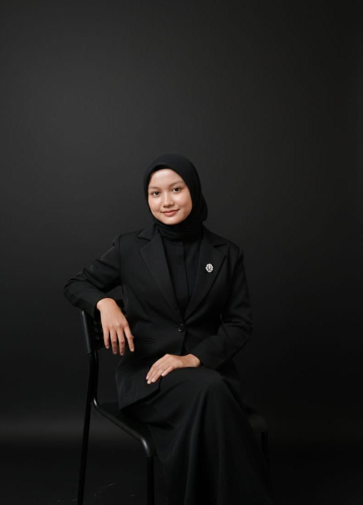

# ✨ Amrina Rasyada — Interactive 3D Portfolio

<p align="center">
  
</p>

<p align="center">
  <b>Future Web Developer & AI Software Engineer</b><br>
  Siswa Kelas 11 Rekayasa Perangkat Lunak & IT di SMKN 5 Telkom Banda Aceh
</p>

<p align="center">
  <a href="https://github.com/Asya-Code2146"></a>
  <a href="mailto:amrinarasya7@gmail.com"></a>
  <a href="https://wa.me/6281360946051"></a>
  <a href="https://instagram.com/amrinarasyada._7"></a>
</p>

---

## 🌟 Tentang Portofolio

Portofolio web interaktif modern yang dibangun dari dasar (*pure vanilla craftsmanship*). Mengusung tema visual **Cosmic Blue & Soft Pink Nebula** dengan efek kedalaman **3D Spatial Cards**, partikel intro sinematik, serta integrasi dinamis dengan GitHub API untuk menampilkan seluruh repositori karya secara otomatis.

---

## 🚀 Fitur Unggulan

- **Cinematographic Particle Intro**: Transisi pembuka animasi partikel interaktif (`!` &rarr; `AMRINA` &rarr; `PORTOFOLIO`) yang halus dan mudah dibaca.
- **Cosmic Nebula & Shooting Stars**: Latar belakang dinamis menggunakan HTML5 Canvas dengan simulasi bintang, konstelasi interaktif, dan kabut nebula biru-pink.
- **True 3D Spatial Tilt**: Setiap card proyek, tech stack, dan foto profil memiliki efek kedalaman 3D nyata dengan sudut elevasi dinamis mengikuti pergerakan kursor mouse.
- **Scroll Reveal Animations**: Konten muncul berurutan secara elegan dan modern seiring pengguna menggulir halaman.
- **Live GitHub Showcase**: Menampilkan seluruh 15 repositori publik dari akun `Asya-Code2146` dengan fitur filter kategori dan pencarian instan.
- **Ultra Responsive**: Tata letak adaptif sempurna di perangkat mobile (360px+), tablet, laptop, hingga monitor desktop resolusi tinggi.
- **Clean Code Architecture**: Dirancang rapi, performa tinggi, dan bebas dari dependensi library eksternal yang lambat.

---

## 🛠️ Tech Stack & Keahlian

### Web & Frontend
<p>
  
  
  
  
  
  
  
  
</p>

### Backend & Bahasa Pemrograman
<p>
  
  
  
  
</p>

### Mobile Development
<p>
  
  
</p>

---

## 📂 Struktur Direktori

```text
amrina-portfolio/
│
├── index.html        # Struktur semantik utama website
├── README.md         # Dokumentasi repositori
│
├── css/
│   └── styles.css    # Sistem styling modern, tema warna, efek 3D & responsif
│
├── js/
│   ├── intro.js      # Engine animasi partikel pembuka teks sinematik
│   └── main.js       # Kontroler galaxy canvas, tilt 3D, filter repo, & interaksi
│
└── assets/
    └── 1.jpeg        # Foto profil resmi Amrina Rasyada
```

---

## ⚡ Cara Menjalankan Secara Lokal

1. **Clone repositori ini:**
   ```bash
   git clone https://github.com/Asya-Code2146/Portofolio.git
   ```

2. **Masuk ke folder proyek:**
   ```bash
   cd Portofolio
   ```

3. **Buka file `index.html`:**
   - Cukup klik dua kali pada file `index.html`, atau
   - Buka menggunakan ekstensi **Live Server** di VS Code.

---

## 📬 Hubungi Saya

Tertarik untuk berkolaborasi dalam proyek cerdas, pengembangan web, atau sistem AI?

- **Email**: [amrinarasya7@gmail.com](mailto:amrinarasya7@gmail.com)
- **WhatsApp**: [+62 813 6094 6051](https://wa.me/6281360946051)
- **LinkedIn**: [Amrina Rasyada](https://linkedin.com)
- **Instagram**: [@amrinarasyada._7](https://instagram.com/amrinarasyada._7)

---

<p align="center">
  Didesain & Dikembangkan dengan ❤️ oleh <b>Amrina Rasyada</b><br>
  Future Web Developer & AI Engineer &copy; 2026
</p>
